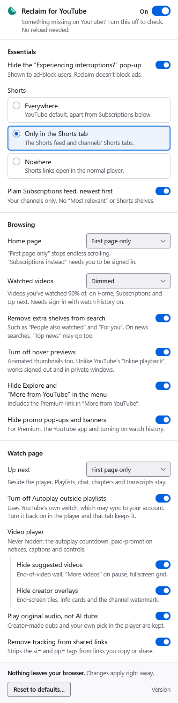
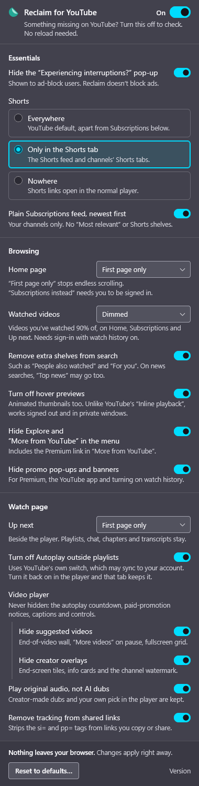

# Reclaim for YouTube

A Firefox add-on that takes YouTube back from the attention machine. Shorts stay in the Shorts tab,
your subscriptions are a plain chronological list again, the ad-block nag popup is gone, and a
handful of other manipulative patterns are switched off, each one a toggle you control.

**Private by construction:** no servers, no analytics, no remote code, no network requests of
its own. Settings live in your browser (`browser.storage.local`) and nothing leaves it.

> Not affiliated with or endorsed by YouTube or Google.

## What it does

| Feature | Default | What changes |
|---|---|---|
| **Hide "Experiencing interruptions?"** | On | Removes the popup YouTube shows to ad-block users, without leaving an invisible box that blocks clicks. |
| **Shorts** | Only in the Shorts tab | Three modes. *YouTube as normal*. *Only in the Shorts tab* means Shorts appear only in the `/shorts` feed and a channel's own Shorts tab, and are hidden everywhere else (home, subscriptions, search, watch-page sidebar, history, notifications). *Remove entirely* also hides the Shorts nav entry and channel tab, opens `/shorts/<id>` links in the normal player, and redirects the Shorts feed away. |
| **Chronological subscriptions** | On | The Subscriptions page shows only your channels' videos, newest first. "Most relevant", Shorts shelves, Playables, Recommended, news and posts are removed. |
| **Home page** | Ends after the first page | *YouTube default*. *Ends after the first page* means no infinite scroll and no injected shelves. *Search box only* means no feed at all. *Subscriptions* opens Subscriptions instead of Home; it needs you to be signed in. |
| **Up next column** | Ends after the first page | *YouTube default*, *Ends after the first page*, or *Hidden*. The playlist panel, live chat and chapters are never affected. |
| **Watched videos** | Dim | Videos you've watched 90%+ are dimmed (or hidden) on Home, Subscriptions and Up next. Search, channels, History and playlists are never touched. |
| **Search results only** | On | Removes "People also watched", "For you", "Previously watched" and similar shelves from search results. A "Latest from" shelf directly after a channel result stays. |
| **Quiet guide** | On | The left menu loses the Explore section, "More from YouTube" and the Premium entry. |
| **Nag scrubber** | On | Removes Premium, YouTube app and "turn your history back on" promos. Legal notices and the ad-blocker warning are never touched. |
| **Autoplay off** | On | Switches YouTube's own Autoplay switch off on each video. Turn it back on in the player and that choice is respected for the tab. Playlists are never affected. *This flips YouTube's own setting, which may sync to your account.* |
| **Clear player** | On | Two parts. *YouTube's suggestions* removes the end-of-video wall, the pause "More videos" and the fullscreen grid. *Creator overlays* removes end-screen tiles, info cards and the watermark. The autoplay countdown, paid-promotion disclosures, captions and player controls are never hidden. |
| **No hover previews** | On | Thumbnails stay still until you click. Inline previews and animated thumbnails are stopped. |
| **Original audio** | On | If YouTube picks an AI auto-dub, it switches back to the creator's original audio, once per video. Creator-made dubs and your own choice in the player are respected. |
| **Clean links** | On | Links you copy or share carry only the video, not YouTube's `si=` / `pp=` tracking parameters (`pp=` encodes what you searched for). |

A master switch in the toolbar popup turns everything off at once, which is the fastest way to
check whether the add-on is why something is missing. Every change applies to open YouTube tabs
immediately, with no reload.

<p align="center">
  
  &nbsp;
  
</p>

## Install

**From source (temporary install, any Firefox 140+):**
1. Download or clone this repository.
2. Open `about:debugging#/runtime/this-firefox` and choose **Load Temporary Add-on…**
3. Select `manifest.json`.

**Packaged build:** `python scripts/build.py` produces `dist/reclaim-for-youtube-<version>.zip`, ready
for [addons.mozilla.org](https://addons.mozilla.org/developers/) submission or self-distribution.

## Permissions

| Permission | Why |
|---|---|
| `storage` | Saves your settings locally. |
| Access to `https://www.youtube.com` | To hide and adjust things on YouTube pages. The add-on runs on no other site. |

The manifest declares `data_collection_permissions: none`. The add-on makes no network requests.

## How it works

- **CSS first.** Most features are stylesheet rules keyed off attributes the content script puts on
  `<html>`, so toggles apply instantly, with no page reload and no flash of hidden content.
- **Fail safe.** Hooks are YouTube's element names, URLs and ARIA attributes rather than class names.
  When YouTube changes its markup, a feature stops matching and YouTube simply looks normal again.
  Nothing breaks.
- **One observer.** A single throttled `MutationObserver` and YouTube's own navigation events drive
  every feature, so nothing polls in a loop.
- **No page scripts.** The add-on never injects scripts into YouTube. The two features that talk to
  the player (Original audio, Clean links) use Firefox's isolated-world Xray APIs.

## Tests

End-to-end tests drive a real Firefox with the add-on installed, via Selenium and geckodriver.

```bash
python -m venv .venv
.venv/Scripts/pip install -r tests/requirements.txt   # macOS/Linux: .venv/bin/pip
.venv/Scripts/python -m pytest                          # fixture suite (offline, deterministic)
.venv/Scripts/python -m pytest -m live                  # against the real www.youtube.com, signed out
```

- **Fixture suite:** YouTube-shaped pages served locally at YouTube's real paths. A test copy of the
  add-on also matches `http://localhost` (patched in a temp folder; the source is never changed).
- **Live suite:** runs the shipped add-on on youtube.com, plus *canaries* that switch features off
  and assert each hook still matches. A failing canary means YouTube changed its markup.
- **Signed-in canary:** some markup (Subscriptions, home feed, watch progress) only exists for a
  signed-in account. Point `RFY_FIREFOX_PROFILE` at a Firefox profile you're signed in to, then run
  `pytest -m signedin`. Selenium works on a temporary copy of the profile, and no password is ever
  needed. Run this before each release.

Set `HEADED=1` to watch the browser, or `FIREFOX_BIN` if Firefox isn't in a standard location.

## Known limitations

- YouTube constantly A/B-tests its markup. The live canaries exist to catch that; please open an
  issue if something reappears.
- Signed-in-only surfaces (the home feed, watch-progress bars, injected search shelves) were built
  against YouTube's known markup and fixture-tested, but can only be checked live with the
  signed-in canary.
- Desktop `www.youtube.com` only. No `m.youtube.com`, YouTube Music or embedded players.

## Design docs

- [`docs/design/`](docs/design/README.md): the popup's information architecture, states, copy deck and
  accessibility notes.
- [`docs/youtube-hooks.md`](docs/youtube-hooks.md): the YouTube markup the features hook into, as
  observed live.

## Roadmap (v1.1)

- **Mute list:** hide channels and title words you never want to see, from the right-click menu.
- **No Ask button:** hide the AI "Ask" button and panel (needs a signed-in markup capture first).
- **Remember my quality:** the resolution you pick by hand sticks for later videos.
- **Original titles:** undo auto-translated titles.

## License

[MIT](LICENSE)
