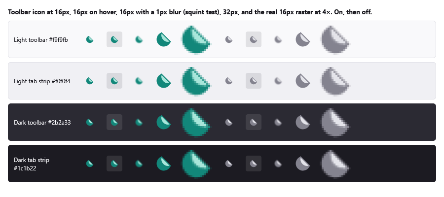

# Reclaim for YouTube: settings UI spec (round 2)

> Design-phase document. The shipped popup lives in [`src/popup/`](../../src/popup) and the icons in
> [`icons/`](../../icons). It also has the final round-2b copy fixes, which supersede any older strings below.


| File | What it is |
|---|---|
| `popup.html`, `popup.css`, `popup.js` | The toolbar popup. Open `popup.html` in Firefox. `#off` opens it paused; `#confirm` opens the reset question. |
| `icon.svg`, `icon-off.svg` | The toolbar icon, and its paused version. |
| `icon-preview.html` / `.png` | The icon on all four Firefox toolbar colours: 16px, hover, a 1px-blur squint test, 32px, and the real 16px raster at 4×. |
| `popup-*.png` | Screenshots rendered in headless Firefox (section 11). |

Scope: 16 controls, made up of the master switch and 15 settings. `noAskButton` moved to v1.1. `nagScrubber` and `cleanLinks` are confirmed.

---

## Round 2 changes

Measured in Firefox at 380px: the popup is **1,495px tall in both states** (was 1,704). There are **18 help strings, 24 lines of help in total (was 35), and 12 of them fit on one line (was 4)**. No help string runs past 2 lines. The masthead is **84px in both states**, so nothing shifts. Every control's right edge sits at **x = 364px**.

| # | Review item | What changed |
|---|---|---|
| **M1** | Too much help text | Every help string was rewritten to say only what the label doesn't. Examples and repetition went; every required fact stayed. Autoplay's "playlists aren't affected" moved into the label ("Turn off Autoplay outside playlists"). Each Shorts card has one line of help. Results are in the measured figures above. |
| **M2** | Labels unreadable while paused | Labels, legends, headings and selects stay `--text` while paused. The muted-label rule is deleted. Only the controls change (S6), plus the masthead. There's no extra paused line in the body, because adding one would shift the layout. Screen-reader users still get "Paused while Reclaim is off." with every control (section 7). |
| **M3** | Off copy didn't match the facts; open questions | The off copy now reads *"YouTube is back to normal, except Autoplay and audio on a video that's already playing."* (engineering: everything applies live except changes already made to the playing video). The on copy adds *"No reload needed."* Watched videos now says *"Needs sign-in with watch history on."* Section 12 has no copy questions left. |
| **M4** | Subscriptions label ambiguous | The label is now *"Plain Subscriptions feed, newest first"*, with help *"Only your channels. No 'Most relevant', Shorts or Playables."* (one line). |
| **M5** | Icon reads as ®; peel invisible | The letter is gone. The peel is larger (a 130° fold) and is the whole mark. The flap edge is a solid 2-unit (1px at 16px) teal stroke, 3.9–4.2:1 on the light toolbars. The off icon uses grey `#84838f`, which is 3.3:1 or better on all four toolbars (the old `#8f8f9d` was 2.8:1 on `#f0f0f4`). The preview adds a squint row and the 4× raster on all four backgrounds. |
| **S1** | Group by where you see it | Sections are now **Essentials · Browsing · Watch page**. `noHoverPreviews` moved to Browsing, and `upNext` moved to Watch page. Scope is defined in principle 3. |
| **S2** | Two "Premium" settings | `quietGuide` is now *"Hide Explore and 'More from YouTube' in the menu"* (help: *"Includes the Premium link in 'More from YouTube'."*). `nagScrubber` is now *"Hide promo pop-ups and banners"* (help: *"For Premium, the YouTube app and turning on watch history."*). Each label names its place. |
| **S3** | Headings smaller than labels | `h2` is now 14px/600 `--text`, the same size as labels but heavier, with 16px above it and a full-width rule. |
| **S4** | Select copy | Every option is now a state: *YouTube default · First page only · Search box only · Subscriptions instead*; *YouTube default · First page only · Hidden*; *YouTube default · Dimmed · Hidden*. Home help explains "First page only". The `value`s are unchanged. |
| **S5** | Shorts option copy | The options read *Everywhere · Only in the Shorts tab · Nowhere*. "Everywhere" is honest about precedence: *"YouTube default, apart from Subscriptions below."* That assumes the plain Subscriptions feed drops Shorts shelves whatever the Shorts setting is, as the brief defines it. If engineering decides the other way, delete "apart from Subscriptions below" and the word "Shorts" from the Subscriptions help. |
| **S6** | Paused switches heavier than active ones | Paused fill is now `#8f8f9d` in light (3.2:1, lighter than the accent's 5.6:1) and `#a5a5b1` in dark (4.1:1, dimmer than cyan's 6.1:1). The same token is used for the paused radio and the selected card's border. |
| **S7** | Masthead jump; muted "Off" | Both master help strings are written to two lines, and there's a `min-block-size` of 2 lines as a guard. "Off" stays `--text` at 600 weight. |
| **S8** | Reset status off-screen; no undo | The status replaces the version text *in the same row*, so the document doesn't grow (1,495 before and after, checked). The row reads *"Defaults restored. [Undo]"*. Undo restores a snapshot taken just before the reset, for as long as the popup stays open. The next change to any setting clears the message. |
| **S9** | Forced colours: selected card weaker | In forced colours the selected card has a real 2px border (`Highlight`, or `GrayText` while paused), with padding reduced by 1px. Checked: it's now the strongest card. |
| **S10** | Video player group | The box is gone. The legend is followed directly by its note (*"Never hidden: …"*), then two ordinary rows indented under a 2px rule. The switches line up at the same right edge (364px). The 13.5px label size is removed. |
| **S11** | Footer fact | The footer now reads ***Nothing leaves your browser.*** *Changes apply right away.* |
| **S12** | cleanLinks may overclaim | The help now reads *"Strips the si= and pp= tags from links you copy or share."* That's true whether or not timestamps and playlists are kept. If engineering confirms they're kept, *"Timestamps are kept."* can be added. |
| N1 | Six type sizes | Down to four: 15, 14, 13 and 12.5. |
| N2 | Acorn buttons | Buttons and selects are 32px high, and buttons are 600 weight. |
| N3 | "As normal" | Changed to "YouTube default" everywhere. |
| N4 | Classic scrollbars | Added `html { scrollbar-gutter: stable }`. Not verified in a real Windows popup with "Always show scrollbars" on (section 12). |
| N5 | Select width | Now 180px. The longest option is 122px against 138px of inner width. |
| N6 | Dim masthead icon in dark | The masthead uses a lighter teal in dark (`#24a896`, 3.4:1). |
| N7 | No hover on paused switches | Added a paused hover state (`--paused-hover`). |
| N8 | One-item Privacy section | Folded `cleanLinks` into Watch page, where the Share button is. The footer keeps the privacy promise. |
| N9 | Toolbar title symmetry | The toolbar title is now "Reclaim for YouTube: on" / "Reclaim for YouTube: off". |
| N10 | Verb-first labels | **Not done**, on purpose. A verb-first label says what "on" does ("Hide…", "Turn off…"), so a switch label never needs decoding. A noun-first label ("Hover previews off") reads as a state, and an "on" switch next to the word "off" invites misreading. Firefox's own settings put the verb first too. |
| N11 | Comments vs the table | CSS comments now quote the table's ratios. |
| (extra) | Quoted names breaking across lines | Multi-word YouTube names in quotes ("More from YouTube", "Subscriptions instead", …) use no-break spaces, and labels use `text-wrap: balance`. The only two-line label splits cleanly, with no orphaned word. |

---

## 1. Surfaces: one popup, no options page

**Everything is in the toolbar popup. There's no separate options page.**

- **All three popup jobs need the full list.** (a) "Is it on?" needs the master switch. (b) "Flip something quickly" can mean any of the 15 settings. (c) "Is the add-on why X is missing?" means scanning for the missing thing. If a setting lived only on an options page, (b) or (c) would end with "now open a tab".
- **One surface, one mental model.** Splitting 15 settings across two pages forces an arbitrary line. Duplicating them on both means two layouts to keep in sync.
- **It fits.** The popup is 1,495px tall, two and a half screens at Firefox's 600px popup height. The first screen holds the master switch and all of Essentials. The master switch is sticky.
- **Nothing here needs a big canvas.** There are no lists, no import or export, and no long-form content. (If the v1.1 mute list arrives, it should get its own options page, linked from the footer.)

Optional, at no design cost: to give about:addons a Preferences tab, point `options_ui.page` at `popup.html` with `open_in_tab: false`. It's the same document.

---

## 2. Information architecture

```
┌ Masthead (sticky, 84px) ─────────────────────────┐
│ [icon] Reclaim for YouTube                On [●] │  enabled
│        Something missing on YouTube? Turn this   │
│        off to check. No reload needed.           │
├──────────────────────────────────────────────────┤
│ Essentials                                       │
│   Hide the "Experiencing interruptions?" pop-up  │  hideInterruptions
│   Shorts  ○ Everywhere                           │  shorts
│           ◉ Only in the Shorts tab               │
│           ○ Nowhere                              │
│   Plain Subscriptions feed, newest first         │  subscriptionsChronological
├──────────────────────────────────────────────────┤
│ Browsing                                         │
│   Home page          [First page only       ▾]   │  homePage
│   Watched videos     [Dimmed                ▾]   │  watchedVideos
│   Remove extra shelves from search               │  searchResultsOnly
│   Turn off hover previews                        │  noHoverPreviews
│   Hide Explore and "More from YouTube" in the menu│ quietGuide
│   Hide promo pop-ups and banners                 │  nagScrubber
├──────────────────────────────────────────────────┤
│ Watch page                                       │
│   Up next            [First page only       ▾]   │  upNext
│   Turn off Autoplay outside playlists            │  autoplayOff
│   Video player   (Never hidden: …)               │
│   │ Hide suggested videos                        │  hideSuggestions
│   │ Hide creator overlays                        │  hideCreatorOverlays
│   Play original audio, not AI dubs               │  originalAudio
│   Remove tracking from shared links              │  cleanLinks
├──────────────────────────────────────────────────┤
│ Nothing leaves your browser. Changes apply right │
│ away.                                            │
│ [Reset to defaults…]                Version 1.0.0│
└──────────────────────────────────────────────────┘
```

### Principles

1. **The master switch comes first and stays on screen.** It's top-right in a sticky masthead. The product name is its label, and the word On or Off sits beside it. The help line is written for job (c).
2. **Essentials get pride of place by position.** The three core features come first and fit on the first screen with the master switch. Shorts is the only setting drawn as radio cards, because its options need a sentence each. This follows Firefox's Tracking Protection choices.
3. **Sections are named for where you see the change.** "Why is X missing?" starts from a place on YouTube.
   - **Browsing:** anything you see while finding videos. That covers Home, the Subscriptions grid, search results, thumbnails, the left menu, and site-wide promo pop-ups and banners.
   - **Watch page:** anything on `/watch`. That covers the Up next column, Autoplay, the player, the audio track, and the Share/copy link.
   - Within each section, mode settings (dropdowns) come first, then switches, roughly from most to least visible.
4. **Labels name what changes, in the "on" state, verb first.** For example "Hide promo pop-ups and banners", "Turn off hover previews". Where two settings touch similar things, the label names the place ("…in the menu" vs "…pop-ups and banners").
5. **Caveats are visible and short.** Every required fact is plain help text, with no tooltips or disclosures. Help says only what the label doesn't, in at most two lines.
6. **No extras.** No counters, badges, ratings prompts, donation nags or "what's new".

### Control types

| Setting | Control | Why |
|---|---|---|
| `enabled` | Large switch (40×22) in the masthead, with an On/Off word | The most important control. |
| `shorts` | Radio cards, one line of help each | A core feature with three options that each need a sentence. |
| `homePage`, `watchedVideos`, `upNext` | `<select>` | The option names explain themselves, and radio lists would add about 300px. Firefox Settings uses dropdowns for similar choices. |
| `hideSuggestions` + `hideCreatorOverlays` | A fieldset: a legend with its note, then two indented switch rows | One feature in two parts, sharing one "never hidden" promise. |
| Every other boolean | A switch (`<input type="checkbox" role="switch">`) | Per the engineering contract. |

---

## 3. Layout and Firefox's popup limits

- **Width:** `body { inline-size: 380px }`. Firefox sizes the popup to the document. `html { scrollbar-gutter: stable }` keeps the right gutter if a classic scrollbar appears.
- **Height:** 1,495px in both states. Firefox caps popups at 600px and scrolls. The masthead is `position: sticky` and 84px tall in both states.
- **Focus never hides under the masthead:** `scroll-padding-block-start: 100px`. Checked with Shift+Tab from the bottom: no focused control ends up under the masthead.
- **First screen (600px):** the masthead, all of Essentials, the "Browsing" heading, the Home page row and the start of Watched videos.
- **Rhythm:** a 16px gutter, 8px vertical padding per row, 2px between a label and its help, and 12px between a label and its control. Sections are separated by full-width rules with 16px above the heading. Inside a section, spacing alone groups the rows.
- **Type (four sizes):** title 15/600, headings and labels 14 (headings at 600), buttons, selects and the On/Off word 13, help 12.5. The system UI font stack, with no web fonts.
- **Firefox look (Acorn):** panel backgrounds `#fff` / `#42414d`, accents `#0061e0` / `#00ddff`, the `moz-toggle` switch pattern, 32px buttons and fields at 600 weight, 4px radius on fields and 6px on cards, and a 2px accent focus ring with 2px offset.
- **No network:** inline SVG, CSS chevrons, no remote anything. Layout uses logical properties throughout, so right-to-left works.

---

## 4. The master switch

### State hook

The settings binder sets **`<html data-paused>`** while `enabled` is off. Everything that depends on the state is driven by that attribute in CSS:
- the On/Off word,
- the masthead copy, background and icon,
- the paused control styling,
- the screen-reader paused note.

The markup uses `.when-on` and `.when-paused` spans, and the hidden one also drops out of accessible names and descriptions. (Checked in Firefox: a `display:none` child of an element that `aria-describedby` points to is left out.) So every `aria-describedby` is static, and the binder needs no knowledge of the UI.

### Behaviour and copy

| | On | Off (paused) |
|---|---|---|
| Visible | Teal icon · **Reclaim for YouTube** · **On** · accent switch with the thumb on the right · *"Something missing on YouTube? Turn this off to check. No reload needed."* | Grey icon · **Off** (full-strength, 600) · outlined switch with the thumb on the left · grey masthead band · *"YouTube is back to normal, except Autoplay and audio on a video that's already playing."* in full-strength text |
| Screen reader | "Reclaim for YouTube, switch, on", followed by the help | "Reclaim for YouTube, switch, off", followed by the off help |
| Toolbar | `icon.svg`, title "Reclaim for YouTube: on" | `icon-off.svg`, title "Reclaim for YouTube: off" |

The On/Off word is a `<label for="enabled">`, so clicking it toggles the switch. The switch's name comes from the `<h1>` through `aria-labelledby`. The off state shows in five ways at once (the word, the thumb position, the switch fill, the band and the icon), never by colour alone.

### While paused: settings stay changeable and readable

**Decision: settings stay enabled.** Only the controls show the pause:
- Checked switches change from the accent colour to a lighter grey fill (`--paused`), with the thumb still on the right.
- The selected Shorts card and its radio turn the same grey.
- **Labels, legends, headings and help keep their normal colours**, so the user can find the setting to blame while Reclaim is off. That's the point of job (c).
- Screen readers hear "Paused while Reclaim is off." before each setting's help.

Why not `disabled`: disabled controls are exempt from contrast rules and end up faint, they drop out of the Tab order, and they stop people from preparing a change before switching back on. The sticky masthead explains the paused state on every screen.

### Reset leaves the master switch alone

Reset restores the 15 feature settings. `enabled` is a temporary pause, not a preference, and the confirmation says so.

---

## 5. Components and states

| Component | Default | Hover | Active | Keyboard focus | Checked / selected | Paused | Disabled* |
|---|---|---|---|---|---|---|---|
| **Switch** 32×18 (master 40×22) | Outlined in `--border-interactive`, muted thumb on the left | Faint track fill | none | 2px accent ring, 2px offset | Accent fill, contrasting thumb on the right; darker or lighter accent on hover and active | Checked: `--paused` fill, thumb on the right, `--paused-hover` on hover. Unchecked: unchanged | 40% opacity |
| **Radio card** (Shorts) | 1px `--card-border`, 6px radius | `--hover` fill | none | Ring around the whole card | 2px accent border (1px plus 1px inset), 7% tint, native dot. Forced colours: real 2px `Highlight` border | `--paused` border and radio, no tint | n/a |
| **Select** 180×32 | `--button-bg`, 1px `--border-interactive`, CSS chevron | `--button-hover` | `--button-active` | 2px accent ring | n/a | Unchanged | n/a |
| **Button** 32px high, 600 weight | Same as the select | `--button-hover` | `--button-active` | 2px accent ring | n/a | Unchanged | n/a |
| **Primary button** | Accent fill, `--on-accent` text | `--accent-hover` | `--accent-active` | 2px accent ring | n/a | n/a | n/a |
| **Video player group** | The legend (a label) and its note, then two rows indented 20px behind a 2px rule | n/a | n/a | n/a | n/a | As switches | n/a |
| **Masthead** | Panel background, bottom rule | n/a | n/a | n/a | n/a | `--bg-off` band, grey icon, "Off", full-strength help | n/a |

\*No control is disabled in this design. The state is defined only so the component is complete.

### Reset flow

The confirmation is inline, and the result stays in place.

1. The footer row shows **[Reset to defaults…]** on the left and *Version 1.0.0* on the right.
2. Clicking the button replaces the row with *"Put every setting back to its default? The on/off switch at the top isn't changed."*, followed by **[Reset settings]** (primary blue, not red) and **[Cancel]**. Focus moves to **Reset settings**, and the group is labelled by the question.
3. **Cancel** or Esc goes back to step 1, with focus on the reset button.
4. **Reset settings** puts the row back. The version text is replaced by *"Defaults restored."* (`role="status"`) and an **[Undo]** button. Focus returns to the reset button, so Undo is one Tab away. The document height doesn't change, so the message is in view.
5. **Undo** restores the snapshot taken just before the reset. The status changes to *"Your settings are back."*, Undo disappears, and focus stays on the reset button. The snapshot lasts until the popup closes.
6. The next change to any setting clears the message and brings back the version.

Reset and Undo only set control values and fire `change`, so the generic binder saves them like any user change.

---

## 6. Copy deck

House style: sentence case. Curly quotes around YouTube's own UI names, with no-break spaces inside multi-word names. "Turn off/on" as verbs, "on/off" as states. Options are states, not commands. No exclamation marks. Never claim more than the feature does.

### Masthead, footer, toolbar

| Where | Copy |
|---|---|
| Title (`h1`, also the master switch's name) | Reclaim for YouTube |
| State word | On / Off |
| Master help, on | Something missing on YouTube? Turn this off to check. No reload needed. |
| Master help, off | YouTube is back to normal, except Autoplay and audio on a video that's already playing. |
| Paused note (screen readers, while off) | Paused while Reclaim is off. |
| Footer | **Nothing leaves your browser.** Changes apply right away. |
| Reset button | Reset to defaults… |
| Reset question | Put every setting back to its default? The on/off switch at the top isn't changed. |
| Reset buttons | Reset settings · Cancel |
| After reset | Defaults restored. · [Undo] |
| After undo | Your settings are back. |
| Version | Version 1.0.0 |
| Toolbar title | Reclaim for YouTube: on · Reclaim for YouTube: off |

### Settings

✓ marks the default. Every boolean defaults to on.

| Section | Key | Label | Help (lines at 380px) |
|---|---|---|---|
| Essentials | `hideInterruptions` | Hide the "Experiencing interruptions?" pop-up | Shown to ad-block users. Reclaim doesn't block ads. (1) |
| | `shorts` | Shorts | none |
| | `show` | Everywhere | YouTube default, apart from Subscriptions below. (1) |
| | `contain` ✓ | Only in the Shorts tab | The Shorts feed and channels' Shorts tabs. (1) |
| | `remove` | Nowhere | Shorts links open in the normal player. (1) |
| | `subscriptionsChronological` | Plain Subscriptions feed, newest first | Only your channels. No "Most relevant", Shorts or Playables. (1) |
| Browsing | `homePage` | Home page: `default` YouTube default · `finite` ✓ First page only · `search` Search box only · `subscriptions` Subscriptions instead | "First page only" stops endless scrolling. "Subscriptions instead" needs you to be signed in. (2) |
| | `watchedVideos` | Watched videos: `show` YouTube default · `dim` ✓ Dimmed · `hide` Hidden | Videos 90% watched, on Home, Subscriptions and Up next. Needs sign-in with watch history on. (2) |
| | `searchResultsOnly` | Remove extra shelves from search | Such as "People also watched" and "For you". On news searches, "Top news" may go too. (2) |
| | `noHoverPreviews` | Turn off hover previews | Animated thumbnails too. Unlike YouTube's "Inline playback", works signed out and in private windows. (2) |
| | `quietGuide` | Hide Explore and "More from YouTube" in the menu | Includes the Premium link in "More from YouTube". (1) |
| | `nagScrubber` | Hide promo pop-ups and banners | For Premium, the YouTube app and turning on watch history. (1) |
| Watch page | `upNext` | Up next: `default` YouTube default · `finite` ✓ First page only · `hidden` Hidden | Playlists, live chat, chapters and transcripts stay. (1) |
| | `autoplayOff` | Turn off Autoplay outside playlists | Uses YouTube's own switch, which may sync to your account. Turn it back on in the player and that tab keeps it. (2) |
| | (group) | Video player | Never hidden: the autoplay countdown, paid-promotion notices, captions and controls. (2) |
| | `hideSuggestions` | Hide suggested videos | End-of-video wall, "More videos" on pause, fullscreen grid. (1) |
| | `hideCreatorOverlays` | Hide creator overlays | End-screen tiles, info cards and the channel watermark. (1) |
| | `originalAudio` | Play original audio, not AI dubs | Creator-made dubs and your own pick in the player are kept. (1) |
| | `cleanLinks` | Remove tracking from shared links | Strips the si= and pp= tags from links you copy or share. (1) |

Every required fact from the brief is still there:
- **Autoplay:** it's YouTube's own switch, it may sync to your account, turning it back on in a tab is respected, and playlists are never affected (now in the label).
- **Home:** "Subscriptions instead" needs sign-in.
- **Up next:** playlists, live chat, chapters and transcripts are never affected.
- **Player:** the "never hidden" list.
- **Hover previews:** the "Inline playback" comparison, plus signed-out, private-window and animated-thumbnail coverage.
- **Search:** the "Top news" caveat.
- **Watched videos:** where it applies, plus the sign-in and watch-history condition.

When `noAskButton` returns in v1.1, it goes in Watch page after `originalAudio`: label *Hide the AI "Ask" button*, help *"And its chat panel."* If it only works with English YouTube, add *"English YouTube only."*

---

## 7. Accessibility

**Structure.** Landmarks are `<header>`, `<main>` and `<footer>`. The product name is `h1` and each section is an `h2`. Sections are labelled by their headings. Shorts and Video player are `<fieldset>` + `<legend>`, with the legend floated so it lays out as normal content.

**Names and descriptions.**
- Every control has a visible `<label for>` or legend.
- `aria-describedby` = `paused-note <own-help>`. The paused note's text is in a child span that's displayed only while paused, so it's read only then.
- Shorts help sits outside the `<label>`, so the radio names stay short, and a stretched `label::after` keeps the whole card clickable.
- The Video player fieldset is described by its "Never hidden" note.
- The master switch is named by the `h1` and has `role="switch"`.

**Keyboard.**
- Tab order follows the visual order. Shorts is one Tab stop, with arrow keys between options.
- Space toggles switches. Arrow keys change radios and selects. Enter or Space activates buttons. Esc cancels the reset question.
- There's no autofocus on open.
- The focus ring is 2px `--focus` with 2px offset, on `:focus-visible` only. The Shorts ring wraps the whole card.
- Scroll padding keeps focus clear of the sticky masthead (checked).
- Reset and Undo manage focus as described in section 5 (checked by keyboard).

**Not colour alone.** Switches show state by thumb position plus fill vs outline, radios by their dot, and the master switch by its word, thumb, band and icon. The paused state is also stated in text: in the masthead, and in the screen-reader note.

**Other.**
- Targets are 32×18 or larger, and labels are clickable too.
- `prefers-reduced-motion` removes the switch slide.
- `color-scheme: light dark` so native dropdown lists and scrollbars follow the theme.
- **Forced colours (checked with `browser.display.document_color_use=2`):**
  - Switches use `CanvasText` outlines, `Highlight` when on and `GrayText` when paused.
  - The selected Shorts card gets a real 2px `Highlight` border, so it's the strongest card (the 1px inset shadow is dropped in this mode).
  - Selects use `Canvas`/`CanvasText`, and the nested-row rule is `CanvasText`.
  - See `popup-forced-colors*.png`.

---

## 8. Colour and contrast

WCAG 2.x ratios. Tokens and comments are in `popup.css`.

| Pair | Light | Dark | Needs |
|---|---|---|---|
| Text on panel | `#15141a`/`#fff` **18.3** | `#fbfbfe`/`#42414d` **9.7** | 4.5 |
| Help text on panel | `#5b5b66` **6.7** | `#cfcfd8` **6.5** | 4.5 |
| Help text on footer | on `#f9f9fb` **6.4** | on `#3a3944` **7.3** | 4.5 |
| Help text on paused masthead | on `#f0f0f4` **5.9** | on `#2b2a33` **9.2** | 4.5 |
| Help text on selected card | **6.1** | **5.4** | 4.5 |
| Text on select/button | on `#f0f0f4` **16.1** | on `#52525e` **7.5** | 4.5 |
| Primary button text | **5.6** | **11.2** | 4.5 |
| Control border (switch off, select, button) | `#7c7c88` **4.1** (3.6 on paused masthead) | `#a5a5b1` **4.1** (5.8 on paused masthead) | 3 |
| Switch on: track vs panel / thumb vs track | `#0061e0` **5.6** / **5.6** | `#00ddff` **6.1** / **11.2** | 3 |
| Switch paused: track vs panel / thumb vs track | `#8f8f9d` **3.2** / **3.2** | `#a5a5b1` **4.1** / **4.1** | 3 |
| Paused is lighter than active | 3.2 < 5.6 ✓ | 4.1 < 6.1 ✓ | n/a |
| Focus ring vs any background | **4.9–5.6** | **6.1–8.6** | 3 |
| Masthead icon disc vs panel (decorative) | `#12877a` **4.4** | `#24a896` **3.4** | none |
| Toolbar icon: teal (disc and flap edge) | `#f9f9fb` **4.2** · `#f0f0f4` **3.9** | `#2b2a33` **3.2** · `#1c1b22` **3.9** | 3 |
| Toolbar icon: mint flap vs teal disc | **3.1** | same | 3 |
| Off icon: grey `#84838f` | `#f9f9fb` **3.6** · `#f0f0f4` **3.3** | `#2b2a33` **3.8** · `#1c1b22` **4.6** | 3 |

---

## 9. Toolbar icon

 16 &nbsp;  32 &nbsp;
 16 off &nbsp;  32 off



**Idea: a layer being peeled back.** The mark is a disc with a large corner lifted off, as if a sticker were being peeled away. It stands for clearing away what's been stuck on top and getting back what's underneath. There's no letter: a letter centred in a disc reads as ®.

- **Not YouTube's mark:** a circle, not a rounded rectangle. Teal, not red. No play triangle.
- **Reads at 16px:** two shapes. The fold covers 130° of the circle, so the flap stays large. The flap's edge is a solid 2-unit teal stroke (1px at 16px), so the fold line holds at 3.9–4.2:1 on light toolbars, where the mint flap alone would be only 1.3:1. On dark toolbars the mint flap itself stands out. The squint row shows the silhouette survives a 1px blur.
- **One file for both toolbars:** teal `#12877a` is 3.2:1 or better on all four Firefox toolbar colours. No `theme_icons` swap is needed.
- **Off:** the same silhouette in grey `#84838f` (3.3:1 or better on all four), set with `browser.action.setIcon` along with the title "…: off". The popup masthead swaps to the same version.
- **Manifest:** `"action": { "default_icon": "icon.svg", "default_title": "Reclaim for YouTube: on" }`, and `"icons": { "48": "icon.svg", "96": "icon.svg" }`.

---

## 10. Engineering notes

- **Contract is unchanged.**
  - `data-setting="<key>"` is on every control. Radios repeat it on each `<input>`, and selects carry it on the `<select>`.
  - Values equal the enum strings. Booleans are checkboxes with `role="switch"`.
  - Verified: 16 keys, the defaults match the brief, enums are `show|contain|remove`, `default|finite|search|subscriptions`, `show|dim|hide` and `default|finite|hidden`, there are no duplicate ids, every `aria-*` reference resolves, and every control has a name.
- **Generic binder:** set every `[data-setting]` from storage on load and on change. Set `<html data-paused>` while `enabled` is false. Nothing else is required: all paused styling, copy swaps and screen-reader notes key off that attribute.
- **`popup.js`** has two parts:
  - The *demo binder* (replace it): it only toggles `data-paused`, and handles `#off` / `#confirm` for previews.
  - *Reset + Undo* (keep it): it sets control values and dispatches `change`, so the binder persists them. It never touches `enabled`.
- **Before first paint:** set controls and `data-paused` before showing the body, so switches don't visibly flip as the popup opens.
- **Toolbar:** on every `enabled` change, call `browser.action.setIcon` (`icon.svg` or `icon-off.svg`) and `setTitle` ("Reclaim for YouTube: on" or "…: off").
- **Copy-backed promises worth a test:**
  - The "Never hidden" list.
  - Autoplay leaves playlists alone.
  - Up next leaves playlists, chat, chapters and transcripts alone.
  - Master off reverts everything live except Autoplay and the audio track on the video already playing.

---

## 11. Screenshots

Rendered in headless Firefox, with the popup inside a 380×600 iframe, the real popup viewport. Headless Firefox won't make a window narrower than about 500px, so `shot.py --width 380` shows the popup with blank panel colour to its right.

| File | Shows |
|---|---|
| `popup-light.png`, `popup-dark.png` | The first screen as opened. |
| `popup-full-light.png`, `popup-full-dark.png` | The whole popup (1,495px). |
| `popup-off-light.png` | Paused: masthead, Essentials. Labels stay readable and switches are a lighter grey. |
| `popup-off-dark.png` | Paused, scrolled into Browsing and Watch page. The sticky masthead still says Off. |
| `popup-off-full-light.png`, `popup-off-full-dark.png` | The whole popup while paused, the same height as when on. |
| `popup-focus-light.png` | Keyboard focus on the Shorts card. |
| `popup-focus-dark.png` | Keyboard focus on the Watched videos select. |
| `popup-reset-light.png`, `popup-reset-dark.png` | The reset question, with focus on Reset settings. |
| `popup-reset-done-light.png`, `popup-reset-done-dark.png` | After reset: "Defaults restored. [Undo]" in place of the version, in view. |
| `popup-forced-colors.png`, `popup-forced-colors-off.png` | Forced colours: the selected card at 2px `Highlight`, and paused switches in `GrayText`. |
| `icon-preview.png` | The icon, on and off, on all four toolbar colours, with the squint test and the 4× raster. |

---

## 12. Open questions

None affecting copy.

Not verified here (each needs a real installed popup):
- **Classic scrollbars on Windows** ("Always show scrollbars" on): confirm the popup widens to 380px plus the scrollbar and doesn't scroll sideways. `scrollbar-gutter: stable` is in place.
- **Esc in the reset question:** the handler calls `preventDefault()`. If Firefox closes the panel anyway, that's acceptable, since nothing has changed by then.
